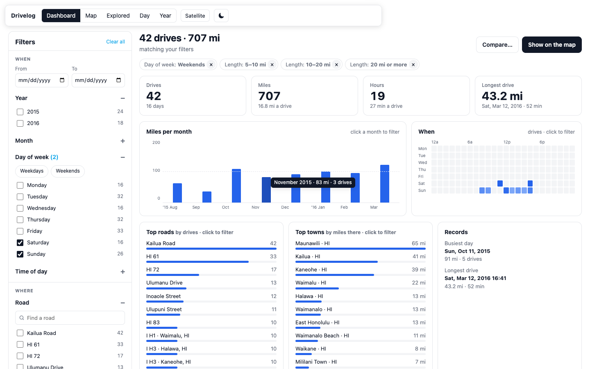
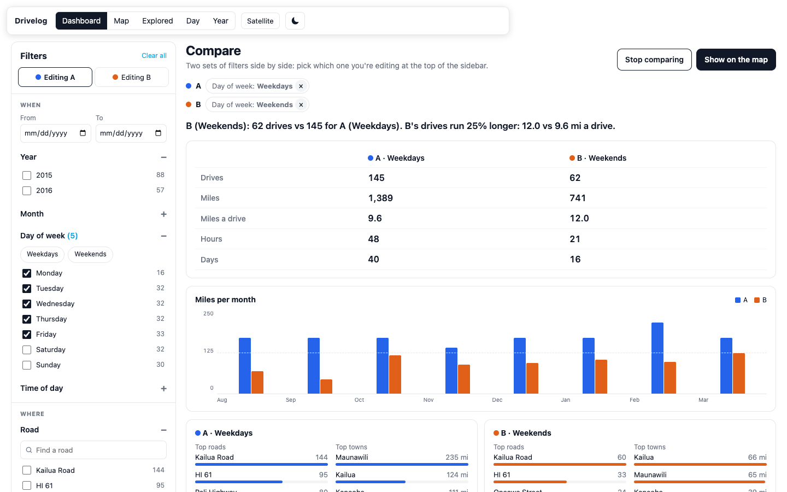
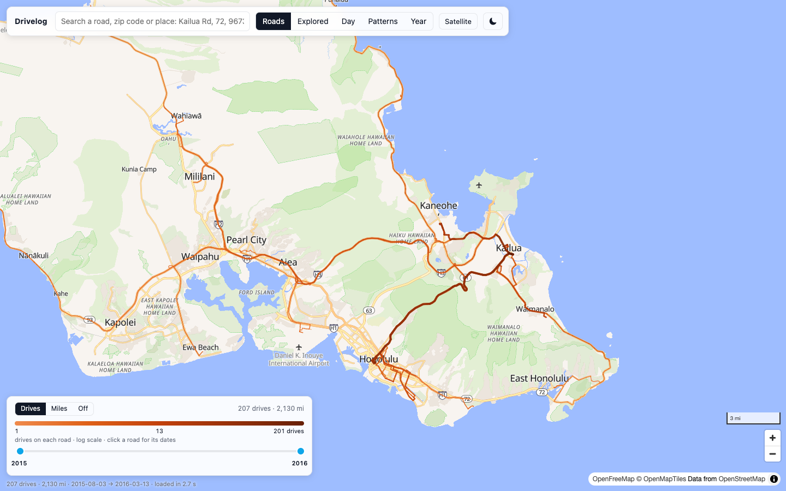
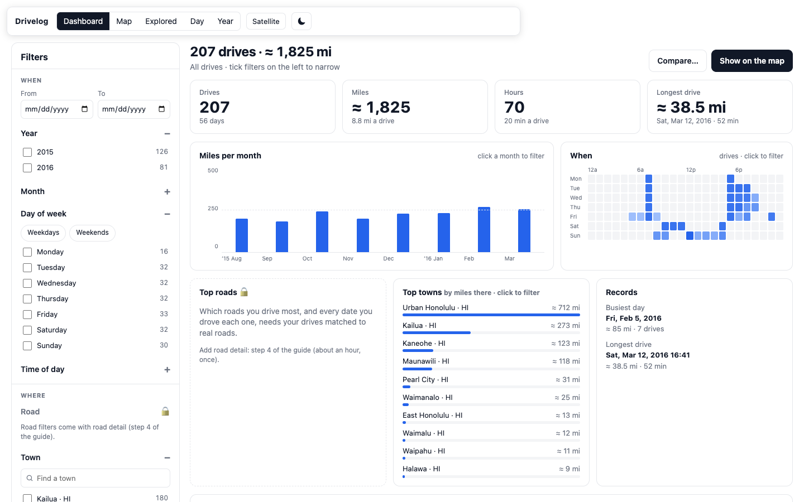

# Drivelog

**Every drive you've ever taken, from your Google Timeline: a dashboard you can filter like a shopping
site, and a map of every road you've driven.** It runs on your own computer. Your location history never
leaves it.



<!-- EDIT ME: this intro is a draft. Replace it with your own words: why you built it, what surprised you. -->
Google has been keeping a record of where I drive for years. I wanted to actually look at it: which roads
I drive most, when I'm on the road, how my weekdays differ from my weekends, how much of the map I've
explored. And I didn't want to upload my location history anywhere to do it. Drivelog is what came out
of that. If I did it, so can you: it's four steps, and the first three take about ten minutes.

## What you get

- **A dashboard you filter like a shop.** Tick any mix of year, month, day of week, time of day, road,
  town, zip code, county, state or country. Every chart, list and total answers for just those drives,
  and each option shows how many drives it would leave.
- **Compare.** Weekdays vs weekends, this year vs last, one town vs another, side by side.
- **The map.** Every road you've driven, coloured by how often. Watch your explored roads grow month by
  month. Street map or satellite. Click any road for every date you drove it.

| Compare two sets of filters | Roads coloured by how often | Explored over time |
|---|---|---|
|  |  |  |

Every screenshot here comes from the bundled demo: an invented driver on Oahu. With your own export the
filters fill with your own places (the demo only has one state and one country).

---

## Step 1 · Get your data

Google keeps Timeline on your phone, so the export is made on the phone. Google moves these menus now and
then; if a step doesn't match, search Google's help for "export Timeline data".

**iPhone:** Google Maps → tap your profile picture → **Settings** → **Personal content** → **Export
Timeline data**. Save the file, then get it onto your Mac (AirDrop works).

<!-- SCREENSHOTS: iPhone export steps go here (see the list in the maintainer's notes). -->

**Android:** your phone's **Settings** → **Location** → **Location services** → **Timeline** → **Export
Timeline data**. Save the file, then copy it to your Mac.

<!-- SCREENSHOTS: Android export steps go here. -->

The file is usually called `Timeline.json` (or `location-history.json`). Keep it somewhere private: it's
your whole location history.

## Step 2 · Install (Mac)

Open **Terminal** (press ⌘-Space, type *Terminal*, press Return) and paste this line:

```sh
curl -LsSf https://astral.sh/uv/install.sh | sh
```

That installs [uv](https://docs.astral.sh/uv/), which runs Drivelog and fetches everything else it needs.
Close Terminal and open it again so it picks uv up.

Then download Drivelog: on this repository's page, click the green **Code** button → **Download ZIP**, and
unzip it (it lands in Downloads). If you use git, `git clone` works too.

## Step 3 · Run it

Move your export into the Drivelog folder and name it `Timeline.json`. In Terminal, go to the folder
and start Drivelog:

```sh
cd ~/Downloads/drivelog-main
uv run drivelog start
```

The first run downloads free map boundary files (about 60 MB, from the US Census and Natural Earth),
reads your export, and opens the dashboard in your browser at http://127.0.0.1:8765. Later runs open in
seconds. To come back another day, run the same two lines.

Want to look around first? `uv run drivelog start --demo` opens the demo data instead.



This is **quick mode**: everything is worked out from your phone's GPS points. Miles are marked "≈"
because the points are minutes apart and the line between them cuts corners, so totals run a little low.
The road features (top roads, road filters, the road map, "explored") show a lock until step 4.

## Step 4 · Road detail (optional, about an hour, once)

This step matches every drive to the real roads you drove, using an open-source routing engine that runs
on your Mac. It unlocks top roads, road filters, every date you drove a road, the road-by-road map, and
exact miles. It takes a while, but it runs unattended.

1. Install [Docker Desktop](https://www.docker.com/products/docker-desktop/) and start it. In its
   Settings → Resources, give it at least **8 GB** of memory (10 GB or more is better; see
   Troubleshooting).
2. Install one helper: `brew install osmium-tool` (no Homebrew? see [brew.sh](https://brew.sh)).
3. In the Drivelog folder, run:

```sh
cp config.example.toml config.toml
uv run drivelog coverage plan     # which map regions cover your drives, and how much disk they need
uv run drivelog coverage apply    # downloads them and builds the routing data (the long part)
uv run drivelog match             # matches every drive to roads
uv run drivelog areas build       # towns, counties and zip codes from the same map data
uv run drivelog start             # the same dashboard, now with roads
```

Keep the Mac awake and plugged in while `coverage apply` runs: building the routing data takes from a few
minutes for one state to over an hour for many, and several times the download size on disk (`coverage
plan` estimates it). Nothing from quick mode needs redoing; the same database is upgraded in place.

**After a new export:** replace `Timeline.json` and run `uv run drivelog rebuild` (only new drives are
processed), then `uv run drivelog start`.

---

## Troubleshooting

- **`command not found: uv`**: close Terminal and open it again after step 2.
- **The export menu isn't where step 1 says**: Google moves it. Search its help for "export Timeline data".
- **"No export at …/Timeline.json"**: the file must be in the Drivelog folder and named exactly
  `Timeline.json` (or set `timeline_path` in `config.toml`).
- **Something else is using port 8765**: `uv run drivelog start --port 8770`, then open that port.
- **Step 4: the routing engine keeps restarting**: Docker needs more memory. With less than 10 GB, set
  `breakage_distance = 5000` in `config.toml`; more of each drive is then routed in the fill stage.
- **Android exports** have only been tested with the synthetic demo export. If yours doesn't load, open an
  issue with the error message. **Never attach the file.**
- **Windows or Linux**: not covered yet. The Python side should work. The install line and paths above are
  Mac-specific.

## Privacy

- **Nothing leaves your computer.** No account, no server, no telemetry. The viewer only listens on
  `127.0.0.1`.
- The network is used to download the free boundary files and map data (Census, Natural Earth, Geofabrik),
  packages, the routing engine's Docker image, and map tiles in the browser (OpenFreeMap for the street map,
  Esri imagery for satellite). Map tiles show those servers which area of the map you're looking at, as with
  any web map. No drive data is in any request.
- Your export, the database and everything derived from it stay in folders git ignores (`Timeline*.json`,
  `data/`, `config.toml`).
- Satellite imagery is Esri's, under Esri's terms (attribution is on the map). It's meant here for personal
  viewing.

## More

- [docs/REFERENCE.md](docs/REFERENCE.md): every command, limits, and development notes.
- [docs/ARCHITECTURE.md](docs/ARCHITECTURE.md): how it works, including how drives are matched to roads and
  how confident each match is.

## License

MIT; see [LICENSE](LICENSE).
