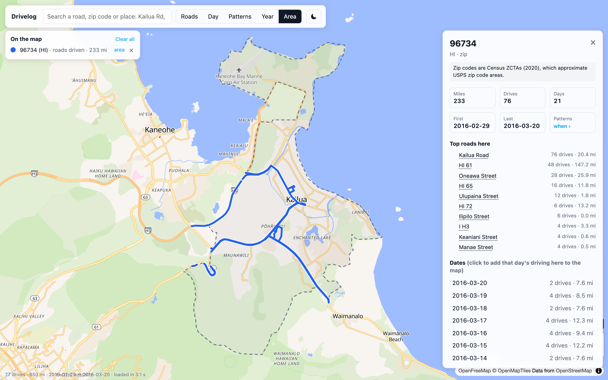
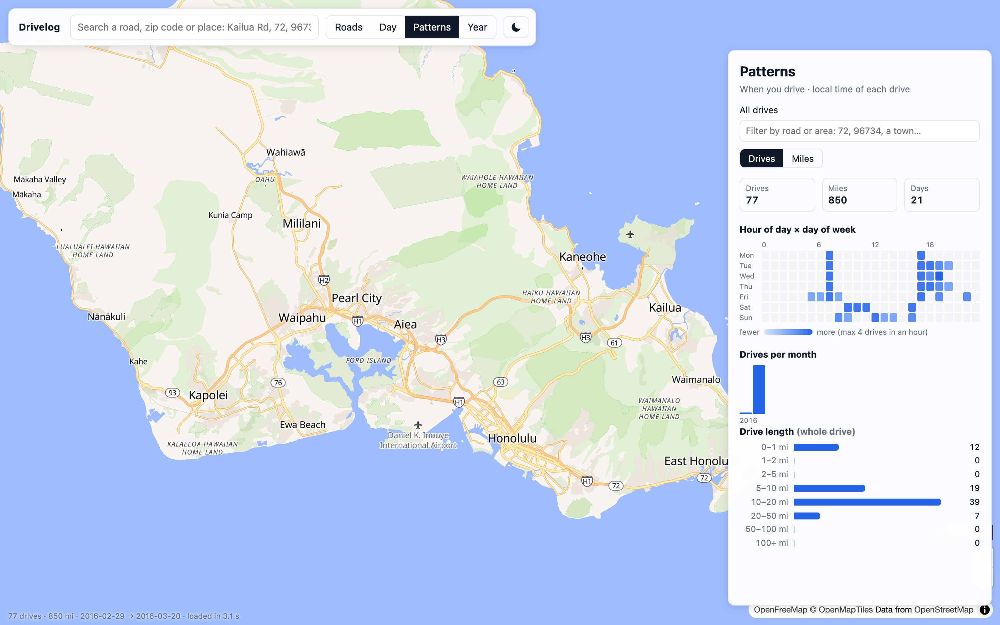
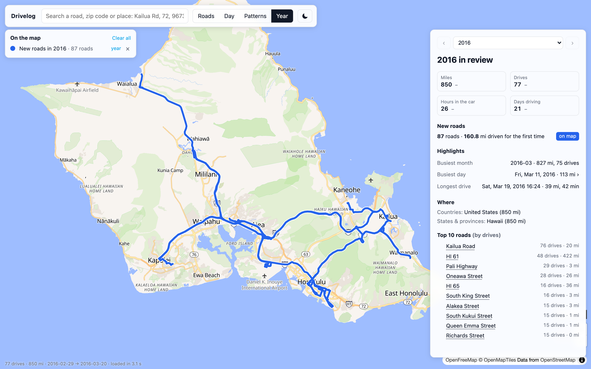

# Drivelog

Every road you've ever driven, from your Google Timeline export: on a map, searchable by road, zip
code or town, with the dates you drove each one and when you tend to drive. It runs entirely on your
own computer; your location history never leaves it.


- **Roads.** Search a road ("Kailua Rd", "72", "HI 72") and see every date you drove it; click a time to
  put that drive on the map. Each road use is marked as seen in your GPS points or inferred across a gap.
- **Places.** Search a zip code, town, county, state or country: miles, drives, days, top roads, and
  the dates you were there.
- **Days and drives.** A day's drives in order, road by road; for any drive, the roads that were new to
  you and other drives that shared its route.
- **Patterns.** Hour of day × day of week, miles per month, drive lengths, for everything or for one
  road or area ("when do I drive the highway", "when am I in this zip code").
- **Year in review.** Miles, drives, hours, days; new roads (drawn on the map); top roads; busiest month
  and day; longest drive; states and countries; each compared with the year before.

| Search a place | Patterns | Year in review |
|---|---|---|
|  |  |  |

All screenshots are from the bundled demo data: an invented driver on Oahu.

## Try it without your own data

```sh
uv sync
uv run drivelog demo
```

`drivelog demo` downloads the small Hawaii map extract (~25 MB), builds routing tiles in a separate
Docker container, loads three weeks of synthetic drives and opens the viewer at http://127.0.0.1:8765.
Everything goes under `data/demo/`. The first run takes a few minutes; later runs take seconds.
`--format android` loads the same drives from the synthetic Android-format export instead.

## Export your Timeline

Google keeps Timeline on your phone, so the export is made on the phone. Google moves these menus from
time to time; if the path has changed, search its help for "export Timeline data".

- **iPhone:** Google Maps → your profile picture → **Settings** → **Personal content** → **Export
  Timeline data**. Save the file and copy it to your computer.
- **Android:** the phone's **Settings** → **Location** → **Location services** → **Timeline** → **Export
  Timeline data**. Save the file and copy it to your computer.

Put the file in this folder as `Timeline.json`, or point `timeline_path` in `config.toml` at it. Drivelog
detects the format itself.

> The Android adapter has only been tested against synthetic data (the demo's Android export). If a real
> Android export doesn't load, please open an issue with the error, **not the file**.

## Setup

You need [Docker Desktop](https://www.docker.com/products/docker-desktop/),
[uv](https://docs.astral.sh/uv/), Node 20+ and osmium-tool. On a Mac: `brew install uv node osmium-tool`.

**Docker memory.** Valhalla, the routing engine, needs room to match sparse traces. Give Docker Desktop
at least **8 GB** (Settings → Resources). With **10 GB or more**, keep `breakage_distance = 10000` in
`config.toml`. With less, set it to `5000`: more of each drive is then routed by the fill stage instead,
and with 10 km in a small VM the routing server runs out of memory and restarts in a loop.

```sh
cp config.example.toml config.toml
uv sync

# Map data for where you drive. After the first extract, let Drivelog pick the rest from your data:
uv run drivelog extract                 # read your export into data/drivelog.duckdb
uv run drivelog coverage plan           # which Geofabrik extracts cover your drives, sizes, disk estimate
uv run drivelog coverage apply          # add them to config.toml, download + verify, build routing tiles

# Or by hand: list extracts in config.toml, then
uv run drivelog valhalla fetch          # download + checksum + merge the extracts
uv run drivelog valhalla compose        # writes docker-compose.yml from config.toml
docker compose up -d                    # first start builds routing tiles (minutes to an hour+)
uv run drivelog valhalla configure && docker compose restart

uv run drivelog match                   # match + fill every drive (resumable)
uv run drivelog aggregate               # road statistics
uv run drivelog areas build             # zip codes and place boundaries
uv run drivelog serve                   # the viewer: http://127.0.0.1:8765
```

After a new export: replace `Timeline.json` and run `uv run drivelog rebuild`. For a trip somewhere new,
run `drivelog coverage plan` and `drivelog coverage apply`: only the newly covered drives are matched.

## Command line

```sh
uv run drivelog top --n 25 [--since 2016-01-01] [--observed-only]
uv run drivelog dates "72"              # every date you drove it; ~ / ? mark inferred drives
uv run drivelog day 2016-03-05          # each drive's roads, in order; *new* = first time on a road
uv run drivelog drive "2016-03-05 11:30"  # one drive: route, new roads, similar drives
uv run drivelog area 96734              # also "Kailua", "Honolulu County", "Kailua, Honolulu County"
uv run drivelog patterns [--road 72 | --area 96734] [--miles]
uv run drivelog review 2016             # or: review all
uv run drivelog stats --by month
```

## Privacy

- **Nothing leaves your machine.** Map matching, routing and area lookups all run locally: Valhalla in
  Docker, DuckDB, and a local viewer. There is no account, server or telemetry.
- The only network use is downloading OpenStreetMap extracts (Geofabrik), Census boundary files,
  packages and the Docker image, plus keyless basemap tiles in the browser. Tile requests reveal which
  map area you're looking at, as with any web map.
- The routing server and the viewer listen on `127.0.0.1` only.
- Your export, the database and everything derived from it stay in gitignored paths (`Timeline*.json`,
  `data/`, `config.toml`).

## Limits

- **Sparse points.** Timeline exports thin the GPS track, so points can be minutes apart. Between them
  the route is **inferred**: `~` means the route fits the time or your usual roads; `?` means low
  confidence ("probably"). Roads known only from inferred stretches draw faded on the map, and
  `drivelog top --observed-only` counts GPS-confirmed use only.
- **Coverage.** Drives outside your map extracts are listed as out of coverage until you add their
  region (`drivelog coverage plan`).
- **Zip codes** are Census ZCTAs, which approximate USPS zip codes.
- **Places** come from OpenStreetMap boundaries; a place that OSM doesn't map as a boundary can't be
  searched by name (search its zip code instead).
- **Same-named streets** in neighbouring towns may split into two roads, or two roads may join, where
  the drives never connect them.

How it works, including the confidence model: [docs/ARCHITECTURE.md](docs/ARCHITECTURE.md).

## License

MIT; see [LICENSE](LICENSE).
