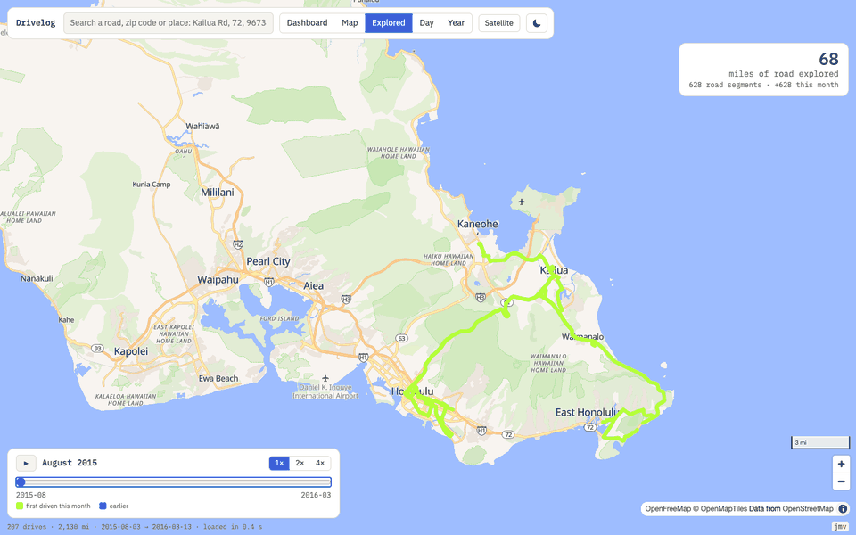
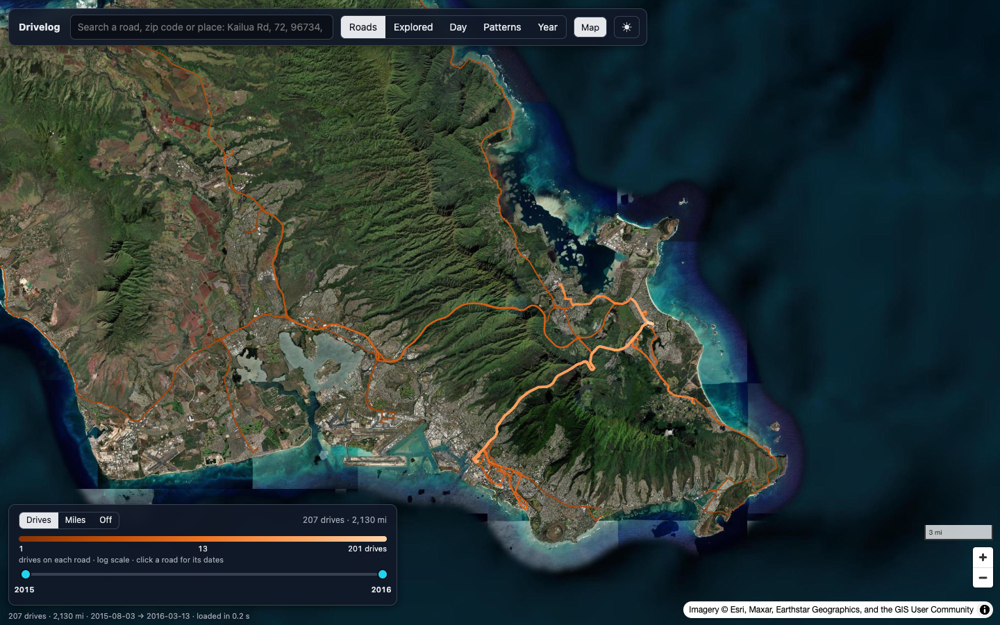
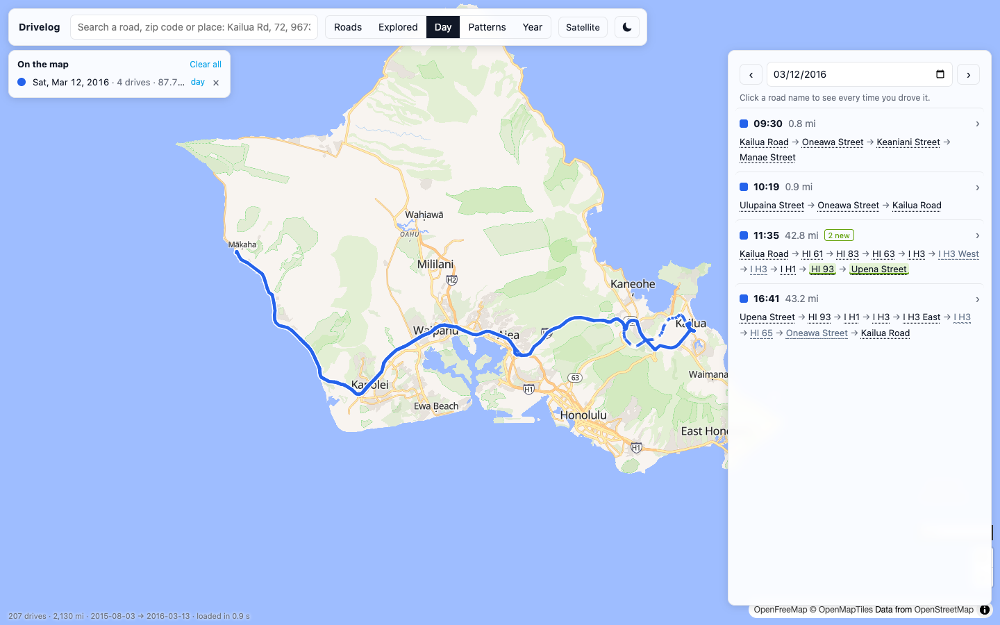

# Drivelog

Every road you've ever driven, from your Google Timeline export: on a map, searchable by road, zip
code or town, with the dates you drove each one and when you tend to drive. It runs entirely on your
own computer; your location history never leaves it.


- **Frequency map.** The opening view: every road you've driven, coloured and weighted by how often
  (drives or miles, log scale, with a legend). A year-range slider recounts it live; click any road
  for its dates.
- **Explored over time.** Press play and watch roads appear the month you first drove them, with a
  running count of distinct road miles explored. Pause, scrub, or change the speed.
- **Roads.** Search a road ("Kailua Rd", "72", "HI 72") and see every date you drove it; click a time to
  put that drive on the map. Each road use is marked as seen in your GPS points or inferred across a gap.
- **Places.** Search a zip code, town, county, state or country: miles, drives, days, top roads, and
  the dates you were there.
- **Days and drives.** A day's drives in order, road by road; for any drive, the roads that were new to
  you and other drives that shared its route.
- **Patterns.** Hour of day × day of week, miles per month, drive lengths, for everything or for one
  road or area ("when do I drive the highway", "when am I in this zip code").
- **Year in review.** Miles, drives, hours, days; new roads (drawn on the map); top roads; busiest month
  and day; longest drive; states and countries; each compared with the year before.
- **The map.** Each day, drive or road history you add goes on the map in its own color, so you can
  compare them side by side. Street map or satellite imagery; light and dark themes.

| Explored over time | Satellite |
|---|---|
|  |  |

| A day's drives | Search a place | Patterns | Year in review |
|---|---|---|---|
|  |  |  |  |

All screenshots are from the bundled demo data: an invented driver on Oahu, eight months of drives.

## Try it without your own data

```sh
uv sync
uv run drivelog demo
```

You need the tools listed under [Setup](#setup) (Docker, uv, Node, osmium-tool); the default Docker
memory is enough for the demo. `drivelog demo` downloads the small Hawaii map extract (~25 MB), builds routing tiles in a separate
Docker container, loads eight months of synthetic drives (the first week of each month) and opens the viewer at http://127.0.0.1:8765.
Everything goes under `data/demo/`, with its own routing container on port 8003, so the demo never
touches your own setup. The first run takes a few minutes; later runs take seconds.
`--format android` loads the same drives from the synthetic Android-format export instead;
`--no-serve` builds the demo database without opening the viewer; `--port` picks another port.

## Export your Timeline

Google keeps Timeline on your phone, so the export is made on the phone. Google moves these menus from
time to time; if the path has changed, search its help for "export Timeline data".

- **iPhone:** Google Maps → your profile picture → **Settings** → **Personal content** → **Export
  Timeline data**. Save the file and copy it to your computer.
- **Android:** the phone's **Settings** → **Location** → **Location services** → **Timeline** → **Export
  Timeline data**. Save the file and copy it to your computer.

Put the file in this folder as `Timeline.json`, or point `timeline_path` in `config.toml` at it. Drivelog
detects the format itself.

> The Android adapter has only been tested against synthetic data (the demo's Android export). If a real
> Android export doesn't load, please open an issue with the error, **not the file**.

## Setup

You need [Docker Desktop](https://www.docker.com/products/docker-desktop/),
[uv](https://docs.astral.sh/uv/) (it installs Python 3.12), Node 20.19+ or 22.12+ and osmium-tool. On a
Mac: `brew install uv node osmium-tool`. The viewer installs and builds its own front end the first time
you run it.

**Docker memory.** Valhalla, the routing engine, needs room to match sparse traces. Give Docker Desktop
at least **8 GB** (Settings → Resources). With **10 GB or more**, keep `breakage_distance = 10000` in
`config.toml`. With less, set it to `5000`: more of each drive is then routed by the fill stage instead,
and with 10 km in a small VM the routing server runs out of memory and restarts in a loop.

Once you've copied the config (first line below), set `fallback_tz` in `config.toml` to your usual time
zone; it's used only for timestamps that carry no UTC offset.

```sh
cp config.example.toml config.toml
uv sync

# Map data for where you drive. After the first extract, let Drivelog pick the rest from your data:
uv run drivelog extract                 # read your export into data/drivelog.duckdb
uv run drivelog coverage plan           # which Geofabrik extracts cover your drives, sizes, disk estimate
uv run drivelog coverage apply          # add them to config.toml, download + verify, build routing tiles

# Or by hand: list extracts in config.toml, then
uv run drivelog valhalla fetch          # download + checksum + merge the extracts
uv run drivelog valhalla compose        # writes docker-compose.yml from config.toml
docker compose up -d                    # first start builds routing tiles (minutes to an hour+)
uv run drivelog valhalla configure && docker compose restart

uv run drivelog split                   # split activities Google stitched across a stop (needs Valhalla)
uv run drivelog match                   # match + fill every drive (resumable)
uv run drivelog aggregate               # road statistics
uv run drivelog areas build             # zip codes and place boundaries
uv run drivelog serve                   # the viewer: http://127.0.0.1:8765
```

`drivelog valhalla health` checks the routing server with a test match of one of your drives.

The tile build is the slow part: from minutes for one small region to over an hour for many, with disk
use of several times the extracts' size (`coverage plan` estimates it). A rebuild keeps the previous
tiles and restores them if the new build fails.

After a new export: replace `Timeline.json` and run `uv run drivelog rebuild` (extracts, splits,
matches and fills only the new drives, then updates road statistics), then `uv run drivelog areas build`. For a trip
somewhere new, run `drivelog coverage plan` and `drivelog coverage apply`: only the newly covered drives
are matched. Then `drivelog areas build` again so the new places are searchable.

## Command line

The examples use the demo data.

```sh
uv run drivelog top --n 25 [--since 2016-01-01] [--until …] [--observed-only] [--by way]
uv run drivelog dates "72" [--limit 20] [--roads 3]   # every date you drove it; ~ / ? mark inferred drives
uv run drivelog day 2016-03-12          # each drive's roads, in order; *new* = first time on a road
uv run drivelog drive "2016-03-12 11:35"  # one drive: route, new roads, similar drives (or an id prefix)
uv run drivelog area 96734              # also "Kailua", "Honolulu County", "Kailua, Honolulu County"
uv run drivelog patterns [--road 72 | --area 96734] [--miles]
uv run drivelog review 2015             # or: review all
uv run drivelog stats --by month        # or year, week, day; --since / --until
```

`drivelog top` counts a road once however OSM splits it; `--by way` lists the individual OSM ways.
Every command has `--help`.

Pipeline stages can also be rerun one at a time: `drivelog match --rematch` (match every drive again),
`drivelog fill --refill` (re-choose the routes across gaps, no rematch needed), `drivelog split
[--dry-run]` (find and split stitched drives, matching only the pieces), `drivelog aggregate`,
and `drivelog validate` (matches a fixed sample of drives and writes a quality report under
`data/reports/`).

## Privacy

- **Nothing leaves your machine.** Map matching, routing and area lookups all run locally: Valhalla in
  Docker, DuckDB, and a local viewer. There is no account, server or telemetry.
- The only network use is downloading OpenStreetMap extracts and their region index and boundaries
  (Geofabrik), Census boundary files, packages and the Docker image, plus keyless basemap tiles in the
  browser: OpenFreeMap for the street map, Esri World Imagery for satellite. Tile requests reveal which
  map area you're looking at, as with any web map; no drive data is in any request.
- Satellite imagery is Esri's, under Esri's terms of use (attribution is shown on the map). It's meant
  here for personal viewing; check Esri's terms before any commercial or high-volume use.
- The routing server and the viewer listen on `127.0.0.1` only.
- Your export, the database and everything derived from it stay in gitignored paths (`Timeline*.json`,
  `data/`, `config.toml`).

## Limits

- **Sparse points.** Timeline exports thin the GPS track, so points can be minutes apart. Between them
  the route is **inferred**: `~` means the route fits the time or your usual roads; `?` means low
  confidence ("probably"). Roads known only from inferred stretches draw faded on the map, and
  `drivelog top --observed-only` counts GPS-confirmed use only.
- **Coverage.** Drives outside your map extracts are listed as out of coverage until you add their
  region (`drivelog coverage plan`).
- **Stitched drives.** Timeline sometimes records several drives (or a whole day) as one activity.
  Drivelog splits an activity wherever the car stood still for 10+ minutes, whether seen in the points
  or hidden in a gap too long for the drive it covers. After a hidden stop the next drive's start time
  is estimated, and the route across that first gap is treated as untimed.
- **Miles** are the length of the matched route. Google's own reported distance is often far too low,
  so it's used only for drives that couldn't be matched.
- **Zip codes** are Census ZCTAs, which approximate USPS zip codes; they cover the US only. Elsewhere,
  search by town, county, state or country.
- **Places** come from OpenStreetMap boundaries; a place that OSM doesn't map as a boundary can't be
  searched by name (search its zip code instead).
- **Same-named streets** in neighbouring towns may split into two roads, or two roads may join, where
  the drives never connect them.

How it works, including the confidence model: [docs/ARCHITECTURE.md](docs/ARCHITECTURE.md).

## Development

```sh
uv run pytest                           # unit tests on synthetic data; routing calls are mocked
uv run drivelog serve --dev             # also runs the Vite dev server with hot reload (port 5173)
uv run python scripts/inspect.py        # profile an export's structure into data/reports/
uv run python scripts/make_demo_data.py # regenerate the demo exports (needs the demo's routing server)
uv run --with playwright --with pillow python scripts/screens.py OUT VIEWS.json  # screenshots + network audit
```

CI runs the tests and builds the viewer on every push.

## License

MIT; see [LICENSE](LICENSE).
